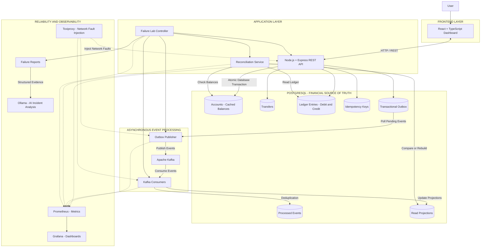

# LedgerLab — System Architecture

## 1. Overview

LedgerLab is a simulated payment ledger system designed to demonstrate financial correctness, distributed systems concepts, fault tolerance, and recovery.

The system uses PostgreSQL as its financial source of truth. It uses a transactional outbox and Apache Kafka to distribute committed transaction events asynchronously. Consumers maintain derived read projections, while a reconciler verifies their consistency with the ledger.

The Failure Lab introduces controlled failures and verifies whether the system preserves its financial invariants and recovers correctly.

## 2. High-Level Architecture

## 3. Component Responsibilities

### 3.1 Frontend — React and TypeScript

The frontend provides the user interface for interacting with LedgerLab.

Responsibilities:

- Create and view simulated accounts.
- Initiate transfers between accounts.
- View account balances and transaction history.
- Run Failure Lab scenarios.
- View reconciliation results and failure reports.

The frontend communicates with the backend through HTTP REST APIs. It does not directly access PostgreSQL or Kafka.

### 3.2 Backend API — Node.js, TypeScript and Express

The backend exposes REST APIs and coordinates financial operations.

Responsibilities:

- Validate incoming requests.
- Handle idempotency keys.
- Check account balances.
- Execute atomic transfer transactions.
- Retrieve account and transaction information.

The API acknowledges a successful transfer only after the PostgreSQL transaction commits.

### 3.3 PostgreSQL — Financial Source of Truth

PostgreSQL stores the authoritative financial records.

Main tables:

- `accounts`: account information and cached balances.
- `transfers`: transfer records.
- `ledger_entries`: debit and credit entries.
- `idempotency_keys`: records used to prevent duplicate financial effects.
- `outbox`: events waiting to be published.
- `processed_events`: event IDs already processed by consumers.
- Read projection tables: derived data used for queries and statements.

A successful transfer writes the transfer record, both ledger entries, balance updates, idempotency information, and outbox event in one database transaction.

The ledger is append-only and serves as the authoritative financial record. Account balances are cached values that can be checked against the ledger.

### 3.4 Transactional Outbox

The transactional outbox solves the dual-write problem between PostgreSQL and Kafka.

The outbox event is inserted in the same PostgreSQL transaction as the financial transfer.

If the database transaction rolls back, the outbox event also rolls back.

If the database transaction commits but the application crashes before publishing the event, the event remains in the outbox and can be published later.

### 3.5 Outbox Publisher

The outbox publisher is a separate background service.

Responsibilities:

- Find pending outbox events.
- Safely claim events for publishing.
- Publish events to Kafka.
- Mark successfully published events.
- Retry failed publishing attempts.

The publisher provides at-least-once delivery. A crash after publishing but before marking an event as published may cause that event to be published again.

### 3.6 Apache Kafka

Kafka is the event streaming platform used to distribute committed transfer events.

It provides:

- Durable event storage.
- Topics and partitions.
- Asynchronous communication between services.
- Event replay and consumer recovery.

Kafka is not the financial source of truth. PostgreSQL remains authoritative.

### 3.7 Kafka Consumers

Consumers read transfer events from Kafka and update derived read projections.

Responsibilities:

- Consume transfer events.
- Identify duplicate events.
- Update projections.
- Handle processing failures.
- Support replay and recovery.

Consumers use a unique event ID in `processed_events` to prevent duplicate effects. Recording the event as processed and updating the projection happen in the same PostgreSQL transaction.

Kafka offsets are committed only after the database transaction succeeds.

### 3.8 Reconciliation Service

The reconciliation service checks whether derived and cached data agrees with the authoritative ledger.

Responsibilities:

- Calculate expected balances from ledger entries.
- Compare calculated balances with cached account balances.
- Compare read projections with ledger-derived results.
- Identify inconsistencies.
- Rebuild derived data when necessary.

The reconciler never silently modifies or deletes historical ledger entries.

### 3.9 Failure Lab

The Failure Lab is responsible for testing system reliability.

It runs controlled scenarios such as:

- Duplicate transfer requests.
- Concurrent transfers.
- API crashes.
- Database failures and latency.
- Kafka shutdown and restart.
- Consumer crashes.
- Network failures using Toxiproxy.

It records the results and checks whether the six financial invariants remain satisfied.

### 3.10 Observability — Prometheus and Grafana

Prometheus collects system metrics, including:

- Request latency.
- Throughput.
- Error rates.
- Outbox backlog.
- Kafka consumer lag.
- Reconciliation mismatches.

Grafana visualizes these metrics through dashboards.

### 3.11 AI-Assisted Incident Analysis — Ollama

Ollama provides local AI-assisted analysis of structured Failure Lab reports.

It can:

- Explain detected failures.
- Summarize recovery behaviour.
- Identify relevant evidence.
- Suggest possible causes.

AI analysis is read-only. It cannot initiate transfers or modify financial records.

## 4. Communication Patterns

### Synchronous Communication

The frontend sends HTTP requests to the backend.

The backend communicates with PostgreSQL and waits for the financial transaction to commit before returning success.

This synchronous path is responsible for financial correctness.

### Asynchronous Communication

After the transfer commits, the outbox publisher publishes its event to Kafka.

Kafka consumers process the event independently and update derived projections.

The transfer API does not wait for all consumers to finish processing.

This asynchronous path supports event distribution, scalability, and recovery.

## 5. Transfer Lifecycle

A typical successful transfer follows these steps:

1. The user initiates a transfer through the React frontend.
2. The backend receives and validates the request.
3. The backend checks the idempotency key.
4. PostgreSQL begins a database transaction.
5. The backend locks the required accounts and checks sufficient funds.
6. PostgreSQL records the transfer and its debit and credit entries.
7. Account balances are updated.
8. The idempotency record and outbox event are inserted.
9. PostgreSQL commits the transaction.
10. The backend acknowledges the successful transfer.
11. The outbox publisher retrieves the pending event.
12. The publisher sends the event to Kafka.
13. Kafka consumers process the event.
14. Consumers update derived projections while preventing duplicate processing.
15. The reconciliation service can verify the derived data against the ledger.

## 6. Failure Handling and Recovery

The system is designed to handle failures without compromising financial correctness.

Examples:

- If the API crashes before the database commits, the transaction rolls back.
- If the API crashes after the database commits but before responding, a retry with the same idempotency key returns the original transfer result.
- If the publisher crashes before publishing, the event remains pending in the outbox.
- If the publisher crashes after publishing but before marking the event as published, the event may be published again.
- If a consumer crashes after updating its database but before committing its Kafka offset, the event may be delivered again. The processed-events mechanism prevents duplicate projection updates.
- If Kafka becomes unavailable, committed financial transactions remain stored in PostgreSQL and pending outbox events can be published when Kafka recovers.
- If projections become inconsistent, the reconciler can identify and rebuild derived data from the ledger.

## 7. Protection of the Six Invariants

| Invariant | Main protection |
|---|---|
| I1: Total money never changes | Balanced ledger entries and transactional balance updates |
| I2: Debits equal credits | Double-entry ledger and database validation |
| I3: No negative balances | Account locking, sufficient-funds checks, database constraints |
| I4: Each acknowledged transfer exists exactly once | Idempotency keys and atomic PostgreSQL transactions |
| I5: No partial transfers | PostgreSQL ACID transactions |
| I6: After recovery, projections equal the ledger | Transactional outbox, idempotent consumers, reconciliation and replay |

## 8. Initial Architecture Decisions

- PostgreSQL is the financial source of truth.
- All monetary amounts are stored as integer paise.
- Transfers use double-entry bookkeeping.
- Financial operations use PostgreSQL transactions.
- Idempotency protects against duplicate financial effects.
- The transactional outbox connects PostgreSQL and Kafka reliably.
- Kafka consumers are designed for duplicate event delivery.
- Read projections are derived from authoritative ledger records.
- The Failure Lab uses controlled fault injection.
- AI incident analysis is local and read-only.
